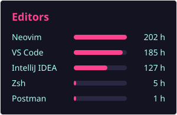
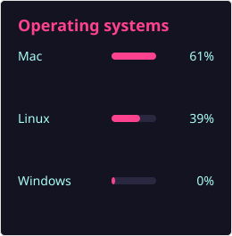

  
  &nbsp;·&nbsp;
  Bachelor of Engineering in Computer Science at NTNU, exchange at UCT
  &nbsp;·&nbsp;
  

Most of my recent work lives in private repos (bachelor thesis on onboard hyperspectral classification for HYPSO, homelab infra, finance tooling). Happy to give access on request.

---

## Organizations

| Role              | Org                                        | Stack                      |
| ----------------- | ------------------------------------------ | -------------------------- |
| Systems Engineer  | [Moen Marin AS](https://www.moenmarin.no/) | Go, TimescaleDB, Docker    |
| DevOps Engineer   | [Orbit NTNU](https://orbitntnu.com)        | CI/CD, Docker, cloud infra |
| Co-founder        | [DuxPace](https://duxpace.no)              | Python, Next.js, AWS       |
| Financial Analyst | [TIHLDE](https://tihlde.org)               | data analysis              |

---

## Projects

| Project                                                                                      | Description                                                                                                                  | Stack                  | With                                                                                                                                                                                                                                                              |
| -------------------------------------------------------------------------------------------- | ---------------------------------------------------------------------------------------------------------------------------- | ---------------------- | ----------------------------------------------------------------------------------------------------------------------------------------------------------------------------------------------------------------------------------------------------------------- |
| [nettdetektivene](https://github.com/TriTacLe/nettdetektivene)                               | Gamified digital safety app for grades 3-7 · **A**                                                                           | Java, Spring Boot, Vue | [aninstan](https://github.com/aninstan), [noralilliedahl](https://github.com/noralilliedahl), [rhj001](https://github.com/rhj001), [Segward](https://github.com/Segward), [siljelund](https://github.com/siljelund), [vetnil1](https://github.com/vetnil1)        |
| [crdt-collab](https://github.com/yazanzarka1/crdt-collab)                                    | Collaborative text editor using CRDT                                                                                         | Rust                   | [yazanzarka1](https://github.com/yazanzarka1), [shaktios](https://github.com/shaktios)                                                                                                                                                                            |
| [Startcode 2025](https://github.com/TriTacLe/Startcode-2025)                                 | Hackathon                                                                                                                    | Dart                   | [BenjaminKvHa](https://github.com/BenjaminKvHa), [aMoltu](https://github.com/aMoltu), [MatejaV2005](https://github.com/MatejaV2005), [aParr0t](https://github.com/aParr0t)                                                                                        |
| [Fondet](https://github.com/TIHLDE/Fondet)                                                   | TIHLDE investment fund               | TypeScript             | [bjosttveit](https://github.com/bjosttveit), [antontveito](https://github.com/antontveito), [LarsMstangeland](https://github.com/LarsMstangeland), [MathiasStrom](https://github.com/MathiasStrom), [minahjuliussen-cell](https://github.com/minahjuliussen-cell) |
| [Makrooppdatering](https://github.com/TIHLDE/Makrooppdatering)                               | Macro terminal for Fondet  | TypeScript, Prisma     | [kajasd](https://github.com/kajasd)                                                                                                                                                                                                                               |
| [DailyQuoteBot](https://github.com/TriTacLe/DailyQuoteBot)                                   | Telegram quotes bot                                                                                                          | Python, Docker         | [rexvelde](https://github.com/rexvelde)                                                                                                                                                                                                                           |
| [Pareto Securities case](https://github.com/TriTacLe/Pareto-Securities-Equity-Research-Case) | Equity research case study                                                                                                   | DCF, Peer-based, FTE   | [sigurdevensen](https://github.com/sigurdevensen), [kajasd](https://github.com/kajasd), Martine                                                                                                                                                                   |

---

## Main Stack

Daily setup: Arch Linux with Hyprland, Neovim, tmux and zsh, almost all in the terminal. Configs in [dotfiles](https://github.com/TriTacLe/dotfiles).

---

## Stats

  
  

  
  

  

